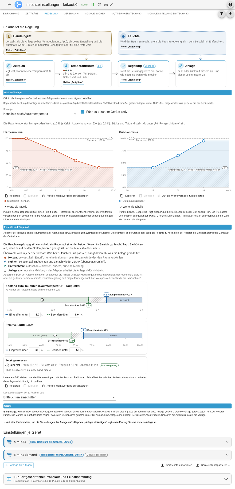
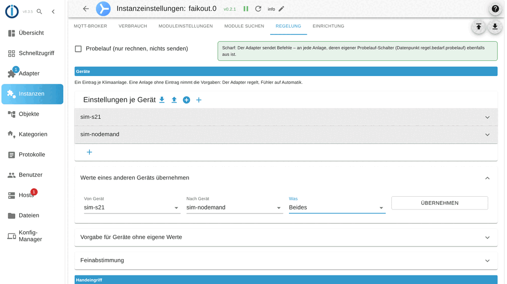
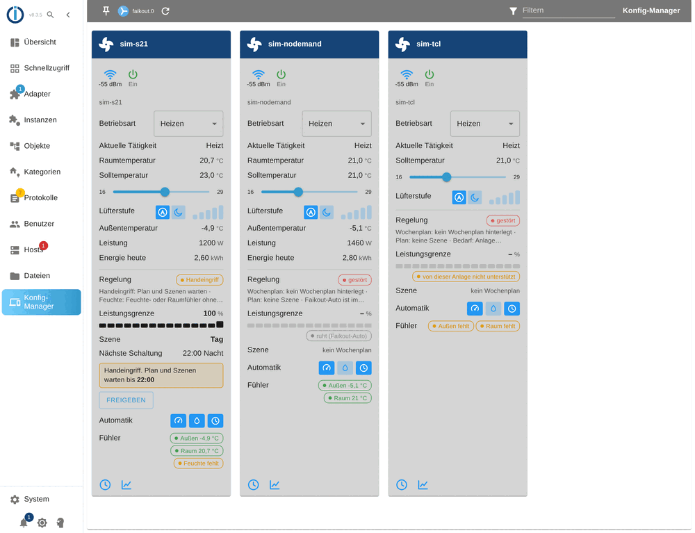
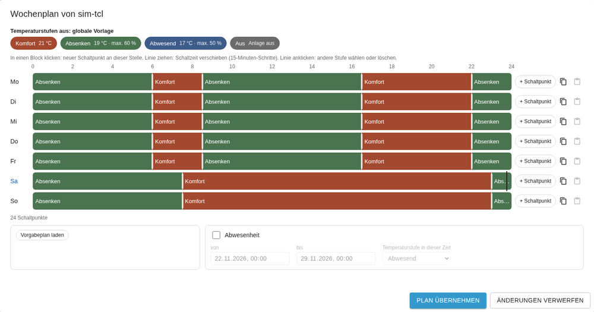
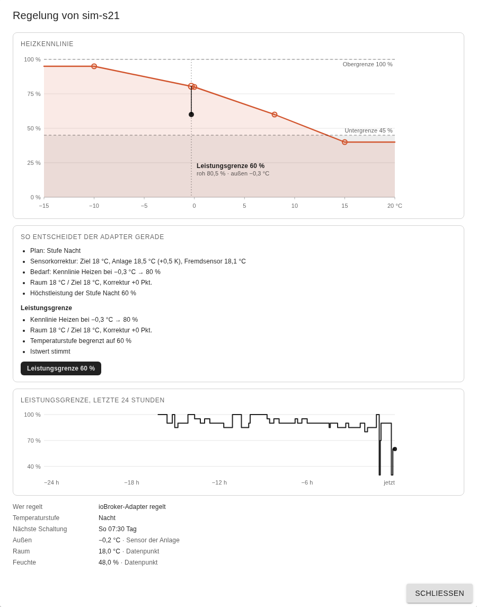
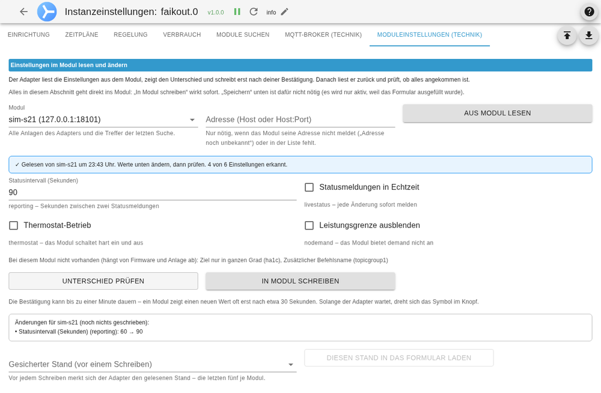

# Faikout – Klimaregelung

Diese Anleitung beschreibt die eingebaute Klimaregelung des Adapters: die Einstellungen im Reiter
**Regelung**, die Gerätekarten, den Wochenplan und das Ändern von Einstellungen im Modul.
[English version](../en/README.md) · [Zurück zur Übersicht](../../README.md)

## 1. Erst einmal nur zusehen: der Probelauf

Nach der Installation steht die Regelung im **Probelauf**. Der Adapter rechnet alles mit und zeigt,
was er senden würde – er sendet aber keinen einzigen Befehl an die Anlagen. So lässt sich in Ruhe
prüfen, ob Kennlinie, Szenen und Wochenplan passen.

Scharf geschaltet wird in zwei Stufen: der Haken **Probelauf** oben im Reiter *Regelung* (für alle
Geräte) und je Gerät der Datenpunkt `<Gerät>.regel.bedarf.probelauf`. Gesendet wird nur, wenn beide
aus sind. Auf der Gerätekarte steht solange das Etikett „Probelauf“.

## 2. Einstellungen je Gerät

Unter **Geräte** gibt es einen Eintrag je Klimaanlage. Eine Anlage ohne Eintrag nimmt die Vorgaben
(Adapter regelt, Fühler auf Automatik, Kennlinie und Szenen aus „Vorgabe für Geräte ohne eigene
Werte“).

### Wer regelt?

| Betriebsart | Was passiert | Geeignet für |
| --- | --- | --- |
| **Adapter regelt** | Der Adapter schaltet nach Wochenplan und Szenen, begrenzt die Leistung nach Bedarf und greift bei Feuchte ein. Im Modul wird dabei nichts gespeichert. | den Normalfall |
| **Faikout-Auto** | Das Modul regelt selbst auf die Zieltemperatur (Automatik der Firmware). Der Adapter liefert Ziel, Fühlerwert und Wochenplan. | wenn das Modul auch ohne ioBroker weiterregeln soll |

Grenzen von Faikout-Auto:

- Die Leistungsgrenze wird nur mit der Strategie **Auto** gesetzt. Mit der Strategie „Kennlinie“
  ruht die Bedarfsregelung; auf der Karte steht dann „ruht (Faikout-Auto)“.
- **Jede Zieländerung wird im Modul gespeichert (Flash-Speicher).** Ändert der Wochenplan das Ziel
  an einem Tag sechsmal oder öfter, warnen der Reiter und der Wochenplan-Dialog. Für Pläne mit
  vielen Schaltpunkten ist „Adapter regelt“ die bessere Wahl.

### Was diese Anlage kann

Hier steht live, ob die Anlage die Leistungsgrenze übernimmt, ob ein BLE-Fühler am Modul hängt und
ob ein Feuchtewert vorhanden ist.

#### Leistungsgrenze bei Daikin

Die Leistungsgrenze (`demand`) wirkt bei Daikin nur, wenn

1. das **originale Daikin-WLAN-Modul eingeschaltet** ist (Fernbedienung: „Powerful“ 5 Sekunden
   halten, bis „SP 1“ erscheint). Internet oder Cloud ist dafür nicht nötig, die App darf offline
   sein – und
2. in der Daikin-App die **Leistungssteuerung auf „Ein“** steht.

„Aus“ bedeutet in der App immer 100 %; Werte vom faikout-Modul sind dann wirkungslos. Bei „Ein“
dürfen App und faikout schreiben, der letzte Wert gilt. „Auto“ heißt: die Cloud regelt. Eine
Ablehnung bei ausgeschalteter Anlage sagt nichts aus – der Adapter zeigt dann weiter „noch nicht
geprüft“.

### Bedarfsregelung (Leistungsgrenze)

Die Bedarfsregelung begrenzt die Leistung der Anlage in 5-%-Stufen, damit sie gleichmäßig
durchläuft statt zu takten. Liegt der Raum 2 K oder mehr unter dem Ziel, gibt der Adapter immer
100 % frei.

- **Kennlinie nach Außentemperatur:** Stützpunkte „Außen °C → Leistung %“ als Tabelle. Das Bild
  daneben zeichnet die Kurve sofort neu, mit Unter- und Obergrenze und – sobald die Anlage Werte
  meldet – dem aktuellen Arbeitspunkt. Die Heizkennlinie muss fallen (je kälter, desto mehr), die
  Kühlkennlinie steigen.
- **Auto (Vortag + Zuschlag):** die Leistung von gestern plus Reserve, so arbeitet auch „Auto“ in
  der Daikin-App. Ohne Daten von gestern gibt der Adapter 100 % frei.

Leere Felder übernehmen die Vorgabe. Eingeschaltet wird die Bedarfsregelung je Gerät auf der
Gerätekarte.

### Szenen

Eine Szene ist ein kompletter Zustand der Anlage: an/aus, Betriebsart, Zieltemperatur, Lüfter und
ein **Deckel**, der die Leistung zusätzlich begrenzt. Je Szene lässt sich festlegen, ob Bedarfs-
und Feuchteregelung in dieser Zeit arbeiten. Ohne eigene Szenen gelten vier Vorgaben: Komfort
(21 °C), Absenken (19 °C), Abwesend (17 °C) und Aus.

### Fühlerquellen und Frostschutz

Für Außentemperatur, Raumtemperatur und Luftfeuchte wählbar:

- **Automatisch** – der beste verfügbare Fühler. Ein BLE-Fühler am Modul hat immer Vorrang (das
  legt die Firmware fest).
- **Fühler der Anlage**, **BLE-Fühler am Modul** oder ein beliebiger **Datenpunkt** aus ioBroker.

Ist ein Wert zu alt, fällt der Adapter auf den nächsten Fühler zurück und zeigt das auf der Karte
gelb an. Bei einem Raum-Datenpunkt gibt es zwei Wege: Die Anlage regelt selbst und der Adapter
gleicht ihren Sollwert an (empfohlen, auch für träge Fühler in einem anderen Raum – der Sollwert
an der Anlage weicht dann um höchstens ±3 K vom Ziel ab), oder der Fühlerwert geht ans Modul.

**Frostschutz:** Unter der eingestellten Raumtemperatur heizt der Adapter auf 10 °C – auch wenn
der Plan „Aus“ vorsieht. 0 schaltet den Frostschutz ab.

### Werte eines anderen Geräts übernehmen

Bei mehreren Geräten lassen sich Szenen, Strategie mit Kennlinie und Grenzen oder beides von einem
Gerät auf ein anderes kopieren. Nach der Rückfrage wird die Geräteliste sofort gespeichert und der
Adapter startet neu – andere ungespeicherte Änderungen auf der Seite vorher speichern.

## 3. Für alle Geräte

- **Handeingriff:** Bedient jemand die Anlage am Gerät oder in einer App, warten Plan und Szenen –
  bis zum nächsten Schaltpunkt, eine feste Dauer oder gar nicht. Bedarfs- und Feuchteregelung
  arbeiten weiter. „Freigeben“ auf der Karte beendet das Warten sofort.
- **Feuchte und Taupunkt:** ΔTP ist der Abstand zwischen Raumtemperatur und Taupunkt. Wird er zu
  klein oder die Feuchte zu hoch, schaltet der Adapter auf Entfeuchten, senkt beim Kühlen das Ziel
  um 1 K oder meldet nur – je nach Einstellung, mit Mindestlaufzeit und Pause.
- **Feiertage:** An Feiertagen kann der Sonntagsplan gelten (bundesweite deutsche Feiertage und
  eigene Daten).

## 4. Gerätekarten

Die Karte zeigt den laufenden Betrieb und bietet die Bedienung des Alltags:

- **Regelung:** Zustand (aktiv, Handeingriff, gestört, keine Verbindung, ausgeschaltet) mit der
  Begründung in Klartext.
- **Leistungsgrenze** als Zahl und Stufenbalken, mit Hinweis, wenn nur gerechnet wird (Probelauf),
  die Regelung ruht oder die Anlage den Wert nicht übernimmt.
- **Szene** und **nächste Schaltung**.
- **Automatik:** drei Symbolknöpfe schalten Bedarfsregelung, Feuchteregelung und Wochenplan ein und
  aus (gefüllt = an).
- **Handeingriff:** Hinweis mit Uhrzeit und Knopf „Freigeben“.
- **Fühler:** grün = gewählter Fühler liefert, gelb = Rückfall oder kein Wert; die Quelle steht im
  Tooltip.

Unten auf der Karte öffnen zwei Knöpfe den **Wochenplan** und die **Details**.

### Wochenplan

- In einen Block klicken: neuer Schaltpunkt an dieser Stelle, danach die Szene wählen.
- Eine Linie ziehen: Schaltzeit verschieben (15-Minuten-Schritte).
- Eine Linie anklicken: andere Szene wählen oder den Schaltpunkt löschen.
- Rechts je Tag: „+ Schaltpunkt“, Tag kopieren, Tag einfügen.
- **Vorgabeplan laden** legt einen einfachen Plan an (werktags morgens und abends, am Wochenende
  tagsüber).
- **Abwesenheit:** von/bis und die Szene, die in dieser Zeit gilt.

Gespeichert wird erst mit „OK“. Ist der Wochenplan des Geräts ausgeschaltet, fragt der Adapter
danach, ob er eingeschaltet werden soll.

### Details

Die Details erklären die aktuelle Entscheidung: Kennlinie mit Arbeitspunkt, der Rechenweg Schritt
für Schritt, die Leistungsgrenze der letzten 24 Stunden und die verwendeten Fühler mit ihrer
Quelle.

## 5. Einstellungen im Modul ändern

Im Reiter **Moduleinstellungen**:

1. Modul wählen (oder Adresse eintragen) und **Aus Modul lesen**. Gelesen wird nur per HTTP GET.
2. Werte im Formular ändern und **Unterschied prüfen** – die Vorschau nennt jede Änderung als
   „alt → neu“.
3. **In Modul schreiben** und die Rückfrage bestätigen. Der Adapter sendet eine einzige
   MQTT-Nachricht mit nur den geänderten Werten, wartet, bis das Modul wieder antwortet, liest
   zurück und zeigt das Ergebnis je Einstellung. Das kann bis zu einer Minute dauern: Ein Modul
   zeigt einen neuen Wert auf seiner Einstellungsseite oft erst nach etwa 30 Sekunden. Solange
   dreht sich das Symbol im Knopf.

Vor jedem Schreiben merkt sich der Adapter den gelesenen Stand (die letzten fünf je Modul). Unter
**Gesicherter Stand** lässt er sich wieder in das Formular laden und mit demselben Ablauf
zurückschreiben.

Wichtig:

- Geschrieben wird nur eine feste Liste: Statusintervall, Statusmeldungen in Echtzeit, Ziel in
  ganzen Grad, Thermostat-Betrieb, Leistungsgrenze ausblenden und der zusätzliche Befehlsname.
  Firmware/OTA, Broker, WLAN, Passwörter und der Name des Moduls lassen sich von hier aus nie
  ändern.
- Welche Einstellungen ein Modul anbietet, hängt von Firmware und Anlage ab. Was fehlt, wird
  genannt und nie geschrieben.
- Jedes Schreiben belastet den Flash-Speicher des Moduls und startet es bei manchen Einstellungen
  neu (etwa 10 Sekunden ohne Verbindung). Bitte gezielt ändern, nicht zum Ausprobieren im
  Minutentakt.

## 6. Eigener oder externer Broker

Ab Werk läuft der **eigene MQTT-Broker** des Adapters – es muss nichts weiter installiert werden,
die Module zeigen einfach darauf. Im Reiter **MQTT-Broker** lässt sich stattdessen ein **externer
Broker** wählen (zum Beispiel Mosquitto oder der MQTT-Adapter von ioBroker). Der Adapter verbindet
sich dann als Client; einzutragen sind Adresse, Port (1883, mit TLS meist 8883), bei Bedarf TLS,
Benutzername, Passwort, Client-ID und ein Topic-Präfix.

- **Verbindung testen** prüft die Werte aus dem Formular schon vor dem Speichern und sagt, ob der
  Broker erreichbar ist, die Anmeldung ablehnt oder nicht antwortet.
- Mit externem Broker läuft der eigene Broker nicht, sein Port wird frei.
- Die Module müssen selbst auf den externen Broker zeigen (Modul-Einstellung `mqtthost`). Der
  Adapter stellt das nicht automatisch um; der Reiter „Module suchen“ zeigt, welche Module noch
  auf einen anderen Broker zeigen, und kann ein Modul umstellen.
- Beim Wechsel gehen keine Daten verloren: Datenpunkte, Wochenpläne und Sicherungen bleiben. Nach
  dem Speichern startet der Adapter neu.

## 7. VIS-Baustein „Regelung“

Der Baustein „Climate control (display)“ zeigt für ein Gerät Zustand, Szene und nächste Schaltung,
die Kennlinie mit Arbeitspunkt, die Leistungsgrenze und welche Regelungen laufen. Er ist reine
Anzeige; bedient wird über die übrigen Bausteine oder die Gerätekarte. Als Attribut genügt das
Geräteobjekt, z. B. `faikout.0.Wohnzimmer`.

## 8. Datenpunkte

Alles, was die Oberfläche zeigt, steht auch als Datenpunkt unter `<Gerät>.regel.*` bereit, unter
anderem `zustand`, `grund`, `bedarf.sollwert`, `plan.szene`, `plan.naechster`, `hand.gesperrt`,
`fuehler.*` sowie die Schalter `bedarf.aktiv`, `feuchte.aktiv` und `plan.aktiv`.
