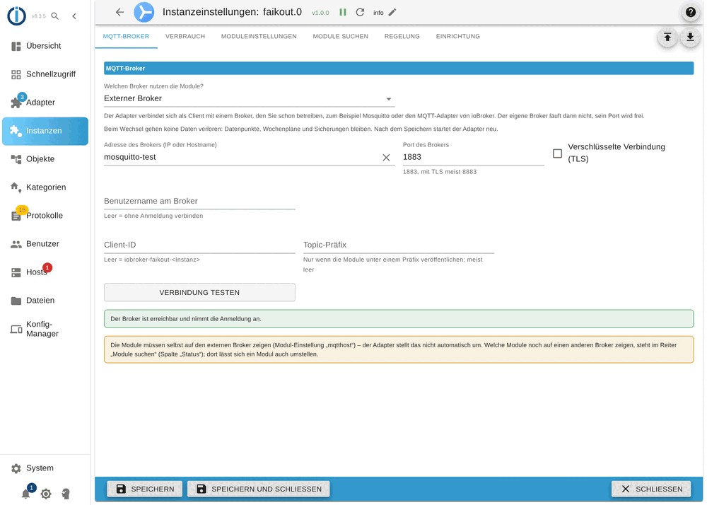
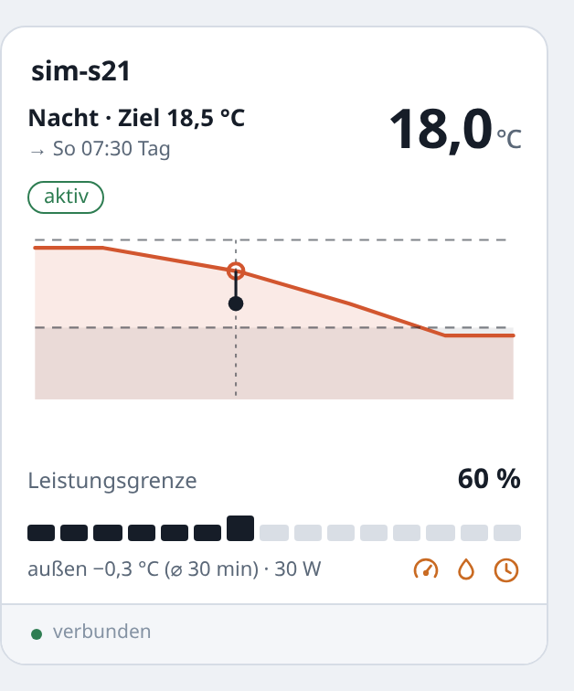

# Faikout – Klimaregelung

Diese Anleitung beschreibt die eingebaute Klimaregelung des Adapters: die Einstellungen im Reiter
**Regelung**, die Gerätekarten, den Wochenplan und das Ändern von Einstellungen im Modul.
[English version](../en/README.md) · [Zurück zur Übersicht](../../README.md)

## 1. Wer mag: erst einmal nur zusehen (Probelauf)

Eine neue Instanz sendet nichts von selbst: Leistungsgrenze, Wochenplan und Feuchteregelung schaltest
du je Anlage ein. Wer vorher in Ruhe prüfen will, ob Kennlinie, Temperaturstufen und Wochenplan passen,
schaltet den **Probelauf** ein: Der Adapter rechnet dann alles mit und zeigt, was er senden würde – er
sendet aber keinen einzigen Befehl an die Anlagen.

Der Haken steht im Reiter *Regelung* ganz unten unter **Für Fortgeschrittene** (für alle Geräte). Ist
er an, steht oben im Reiter ein farbiger Hinweis und auf den Gerätekarten das Etikett „Probelauf“. Das
ist der **eine** Schalter: Ist er aus, senden alle Anlagen.

Soll bewusst nur eine einzelne Anlage im Probelauf bleiben, setzt du in ihrer Karte (Reiter *Regelung*,
Abschnitt *Geräte*) unter **Für Fortgeschrittene** den Haken „Nur diese Anlage im Probelauf“. Gesendet
wird an eine Anlage also nur, wenn der Probelauf für alle aus ist und ihr eigener Haken nicht gesetzt ist.

Der Datenpunkt `<Gerät>.regulation.demand.dryRun` zeigt je Anlage an, ob der Probelauf gerade wirkt. Er
ist **kein Schalter** (nicht beschreibbar); ein Schreibversuch wird mit einem Hinweis im Log abgelehnt.
In Vorabständen war er ein zweiter Schalter je Gerät: Beim Update werden vorhandene Werte einmal an die
Einstellung der Instanz angeglichen. Instanzen aus älteren Versionen behalten dabei ihren Probelauf – dort
bleibt er an, bis du ihn ausschaltest; steht er schon auf aus, senden danach auch Geräte, deren alter
Geräteschalter noch auf an stand (das Log nennt sie beim ersten Start mit einer Warnung).

Die Geräteliste lässt sich unter den Karten als JSON-Datei **exportieren** und wieder **importieren**
(ersetzen oder hinzufügen, mit Rückfrage; gespeichert wird erst mit „Speichern“).

### Die Reiter der Einstellungsseite

| Reiter | Was dort steht |
|---|---|
| **Einrichtung** | Schrittliste mit Haken: Broker, Modul verbinden, Regelung, Zeitplan |
| **Zeitpläne** | WANN welche Temperatur gilt: Temperaturstufen der Vorlage (Regler zum Ziehen), Wochenplan der Vorlage und je Gerät Vorschau, Schalter und „Wochenplan bearbeiten“. Eingeklappt: Handeingriff und Feiertage |
| **Regelung** | WIE die Anlage gefahren wird: Schaubild der Regelung, die globale Vorlage (Strategie, Heiz- und Kühlkennlinie mit Grenzen im Bild, Feuchte-Grenzen im Bild), darunter die Geräte als Karten. Eingeklappt: Probelauf und Feinabstimmung |
| **Verbrauch** | Diagramm und Aufzeichnung |
| **Module suchen**, **MQTT-Broker (Technik)**, **Moduleinstellungen (Technik)** | Anbinden und Technik |

Je Gerät sind im Reiter *Regelung* immer sichtbar: wer regelt, Fühler (mit Live-Wert) und Frostschutz.
Strategie, Kennlinien und die eigenen Temperaturstufen des Geräts erscheinen erst mit dem Haken
**„Individuell statt globaler Vorlage“**; ein farbiger Kasten sagt, was gerade gilt.

## 2. Vorlage und Einstellungen je Gerät

Die Regelung kennt genau zwei Ebenen:

- die **globale Vorlage** – Strategie, Unter- und Obergrenze, Heiz- und Kühlkennlinie, Vortag,
  Temperaturstufen, Feuchte-Maßnahme und der Wochenplan der Vorlage. Sie gilt für alle Anlagen.
- **je Gerät** ein Eintrag unter **Geräte** mit dem Haken **„Individuell statt globaler Vorlage“**.

| Haken „Individuell“ | Was für das Gerät gilt |
|---|---|
| aus (Vorgabe für neue Einträge) | **alle** Werte der Vorlage. Was im Eintrag an eigenen Kennlinien, Grenzen oder Temperaturstufen steht, bleibt gespeichert, wird aber nicht benutzt. |
| an | die Werte des Geräts. Ein einzelnes leeres Feld übernimmt weiter die Vorlage (und diese die Werksvorgabe). |

Immer gerätebezogen – mit und ohne Haken – sind: wer regelt, die Fühlerquellen und der Frostschutz.
Eine Anlage ganz ohne Eintrag nimmt die Vorlage, der ioBroker-Adapter regelt und die Fühler stehen auf
Automatik.

Die Werksvorgaben der Vorlage: Untergrenze **40 %**, Obergrenze **100 %**, Heizkennlinie
−10 °C → 100 %, 0 °C → 75 %, 7 °C → 55 %, 15 °C → 40 %, Kühlkennlinie 25 °C → 40 %, 30 °C → 65 %,
35 °C → 95 %.

### Wer regelt?

| Betriebsart | Was passiert | Geeignet für |
| --- | --- | --- |
| **ioBroker-Adapter regelt** | Der Adapter schaltet nach Wochenplan und Temperaturstufen, begrenzt die Leistung nach Bedarf und greift bei Feuchte ein. Im Modul wird dabei nichts gespeichert. | den Normalfall |
| **Faikout-Auto** | Das Modul regelt selbst auf die Zieltemperatur (Automatik der Firmware). Der Adapter liefert Ziel, Fühlerwert und Wochenplan. | wenn das Modul auch ohne ioBroker weiterregeln soll |

Grenzen von Faikout-Auto:

- Die Leistungsgrenze wird nur mit der Strategie **Auto** gesetzt. Mit der Strategie „Kennlinie“
  ruht die Bedarfsregelung; auf der Karte steht dann „ruht (Faikout-Auto)“.
- **Jede Zieländerung wird im Modul gespeichert (Flash-Speicher).** Ändert der Wochenplan das Ziel
  an einem Tag sechsmal oder öfter, warnen der Reiter und der Wochenplan-Dialog. Für Pläne mit
  vielen Schaltpunkten ist „ioBroker-Adapter regelt“ die bessere Wahl.

### Was diese Anlage kann

Hier steht live, ob die Anlage die Leistungsgrenze übernimmt, ob ein BLE-Fühler am Modul hängt und
ob ein Feuchtewert vorhanden ist.

#### Leistungsgrenze bei Daikin

Die Leistungsgrenze (`demand`) wirkt bei Daikin nur, wenn

1. das **originale Daikin-WLAN-Modul eingeschaltet** ist (Fernbedienung: „Powerful“ 5 Sekunden
   halten, bis „SP 1“ erscheint). Internet oder Cloud ist dafür nicht nötig, die App darf offline
   sein – und
2. in der Daikin-App die **Leistungssteuerung auf „Ein“** steht.

„Aus“ bedeutet in der App immer 100 %; Werte vom faikout-Modul sind dann wirkungslos. Bei „Ein“
dürfen App und faikout schreiben, der letzte Wert gilt. „Auto“ heißt: die Cloud regelt. Eine
Ablehnung bei ausgeschalteter Anlage sagt nichts aus – der Adapter zeigt dann weiter „noch nicht
geprüft“.

### Bedarfsregelung (Leistungsgrenze)

Die Bedarfsregelung begrenzt die Leistung der Anlage in 5-%-Stufen, damit sie gleichmäßig
durchläuft statt zu takten. Liegt der Raum 2 K oder mehr unter dem Ziel, gibt der Adapter immer
100 % frei – auch über eine niedrigere Obergrenze und über die Höchstleistung der Temperaturstufe
hinweg. Erreicht dagegen die Kennlinie selbst 100 % (Werksvorgabe bei −10 °C), ist das ein normaler
Wert: Die Höchstleistung der Temperaturstufe begrenzt ihn weiter.

- **Kennlinie nach Außentemperatur:** Stützpunkte „Außen °C → Leistung %“, im Bild mit der Maus zu
  ziehen (die Tabelle dazu ist eingeklappt). Das Bild zeigt Unter- und Obergrenze und – sobald die
  Anlage Werte meldet – den aktuellen Arbeitspunkt. Die Heizkennlinie muss fallen (je kälter, desto mehr), die
  Kühlkennlinie steigen.
- **Auto (Vortag + Zuschlag):** die Leistung von gestern plus Reserve, so arbeitet auch „Auto“ in
  der Daikin-App. Ohne Daten von gestern gibt der Adapter 100 % frei.

Leere Felder übernehmen die Vorgabe. Eingeschaltet wird die Bedarfsregelung je Gerät auf der
Gerätekarte.

### Temperaturstufen

Temperaturstufen (früher „Szenen“) stehen im Reiter **Zeitpläne** – dort, wo sie gebraucht werden: Der
Wochenplan schaltet zwischen ihnen um. Eine Temperaturstufe ist ein kompletter Zustand der Anlage:
an/aus, Betriebsart, Zieltemperatur, Lüfter und eine **Höchstleistung**, die die Leistung aus der
Regelung zusätzlich begrenzt. Je Stufe lässt sich festlegen, ob Bedarfs- und Feuchteregelung in
dieser Zeit arbeiten. Ohne eigene Stufen gelten vier Werksstufen:

| Stufe | Ziel | Lüfter | Höchstleistung |
|---|---|---|---|
| Komfort | 21 °C | Auto | 100 % |
| Absenken | 19 °C | Nacht | 60 % |
| Abwesend | 17 °C | Auto | 50 % |
| Aus | Anlage aus | – | – |

Die Stufen der Vorlage gelten für alle Geräte; ein Gerät mit dem Haken „Individuell“ kann eigene
haben.

### Fühlerquellen und Frostschutz

Für Außentemperatur, Raumtemperatur und Luftfeuchte wählbar:

- **Automatisch** – der beste verfügbare Fühler. Ein BLE-Fühler am Modul hat immer Vorrang (das
  legt die Firmware fest).
- **Fühler der Anlage**, **BLE-Fühler am Modul** oder ein beliebiger **Datenpunkt** aus ioBroker.

Ist ein Wert zu alt, fällt der Adapter auf den nächsten Fühler zurück und zeigt das auf der Karte
gelb an. Bei einem Raum-Datenpunkt gibt es zwei Wege: Die Anlage regelt selbst und der Adapter
gleicht ihren Sollwert an (empfohlen, auch für träge Fühler in einem anderen Raum – der Sollwert
an der Anlage weicht dann um höchstens ±3 K vom Ziel ab), oder der Fühlerwert geht ans Modul.

**Frostschutz:** Unter der eingestellten Raumtemperatur heizt der Adapter auf 10 °C – auch wenn
der Plan „Aus“ vorsieht. 0 schaltet den Frostschutz ab.

### Kopieren, Einfügen, Zurücksetzen

Unter jeder Grafik (Kennlinie, Temperaturstufen, Feuchte, Wochenplan) stehen drei Knöpfe:
**Kopieren** merkt den Inhalt, **Einfügen** setzt ihn bei einem anderen Gerät oder in der Vorlage ein
(grau, solange nichts Passendes kopiert ist), **Vorlage übernehmen** bzw. **Auf die Werksvorgabe
zurücksetzen** setzt zurück. Nach dem Einfügen oder Zurücksetzen erscheint kurz **Rückgängig**. Kennlinien, Stufen und
Feuchte-Grenzen gelten erst mit „Speichern“; ein Wochenplan am Gerät wirkt sofort.

## 3. Für alle Geräte

- **Handeingriff:** Bedient jemand die Anlage am Gerät oder in einer App, warten Plan und Temperaturstufen –
  bis zum nächsten Schaltpunkt, eine feste Dauer oder gar nicht. Bedarfs- und Feuchteregelung
  arbeiten weiter. „Handeingriff beenden“ auf der Karte beendet das Warten sofort.
- **Feuchte und Taupunkt:** ΔTP ist der Abstand zwischen Raumtemperatur und Taupunkt. Wird er zu
  klein oder die Feuchte zu hoch, schaltet der Adapter auf Entfeuchten, senkt beim Kühlen das Ziel
  um 1 K oder meldet nur – je nach Einstellung, mit Mindestlaufzeit und Pause.
- **Feiertage:** An Feiertagen kann der Sonntagsplan gelten (bundesweite deutsche Feiertage und
  eigene Daten).

## 4. Gerätekarten

Die Karte zeigt den laufenden Betrieb und bietet die Bedienung des Alltags:

- **Regelung:** Zustand (aktiv, Handeingriff, nicht eingerichtet, gestört, keine Verbindung,
  ausgeschaltet) mit der Begründung in Klartext. „Nicht eingerichtet“ heißt: Der Wochenplan ist
  eingeschaltet, aber noch keiner hinterlegt (dann erscheint oben der Knopf „Plan anlegen“), oder
  Faikout-Auto ist im Modul noch aus. Rot („gestört“) steht nur bei echten Störungen.
- **Solltemperatur:** Schieber für große Schritte, die Knöpfe − und + daneben für je einen Schritt
  der Anlage (meist 0,5 K).
- **Fühler:** Fehlt ein gewählter Datenpunkt, nennt die Karte ihn mit Namen und sagt, welcher
  Fühler stattdessen gilt.
- **Leistungsgrenze** als Zahl und Stufenbalken, mit Hinweis, wenn nur gerechnet wird (Probelauf),
  die Regelung ruht oder die Anlage den Wert nicht übernimmt.
- **Temperaturstufe** und **nächste Schaltung**, darunter der Verweis auf den Knopf „Wochenplan“.
- **Automatik:** drei Symbolknöpfe schalten Bedarfsregelung, Feuchteregelung und Wochenplan ein und
  aus (gefüllt = an).
- **Handeingriff:** Hinweis mit Uhrzeit und Knopf „Handeingriff beenden“.
- **Fühler:** grün = gewählter Fühler liefert, gelb = Rückfall oder kein Wert; die Quelle steht im
  Tooltip.

Unten auf der Karte öffnet der beschriftete Knopf **Wochenplan** (mit Kalendersymbol) den Wochenplan
dieser Anlage, der Knopf daneben die **Details**.

### Wochenplan

Den Wochenplan gibt es an zwei Stellen – es ist derselbe Editor und derselbe Plan:

- im Reiter **Zeitpläne** der Einstellungen: je Gerät eine Zeile mit der Woche als Vorschau, Schalter
  „aktiv“ und „Wochenplan bearbeiten“; Pläne lassen sich zwischen Geräten kopieren und einfügen,
- auf der **Gerätekarte**: Knopf „Wochenplan“.

Der Wochenplan liegt je Gerät im Datenpunkt `regulation.schedule.weekJson` und **wirkt sofort** – er
braucht kein „Speichern“ der Einstellungsseite. Der **Plan der Vorlage** dagegen ist ein Wert der
Einstellungen: „Vorgabeplan laden“ im Editor setzt ihn ein (ohne Plan der Vorlage den Werksplan).

- In einen Block klicken: neuer Schaltpunkt an dieser Stelle, danach die Temperaturstufe wählen.
- Eine Linie ziehen: Schaltzeit verschieben (15-Minuten-Schritte).
- Eine Linie anklicken: andere Stufe wählen oder den Schaltpunkt löschen.
- Rechts je Tag: „+ Schaltpunkt“, Tag kopieren, Tag einfügen.
- **Vorgabeplan laden** setzt den Plan der Vorlage ein; ohne einen solchen den Werksplan (werktags
  morgens und abends Komfort, am Wochenende tagsüber).
- **Abwesenheit:** von/bis und die Temperaturstufe, die in dieser Zeit gilt.

Gespeichert wird erst mit „Plan übernehmen“. Ist der Wochenplan des Geräts ausgeschaltet, fragt der Adapter
danach, ob er eingeschaltet werden soll.

### Details

Die Details erklären die aktuelle Entscheidung: Kennlinie mit Arbeitspunkt, der Rechenweg Schritt
für Schritt, die Leistungsgrenze der letzten 24 Stunden und die verwendeten Fühler mit ihrer
Quelle.

## 5. Einstellungen im Modul ändern

Im Reiter **Moduleinstellungen**:

1. Modul wählen (oder Adresse eintragen) und **Aus Modul lesen**. Gelesen wird nur per HTTP GET.
2. Werte im Formular ändern und **Unterschied prüfen** – die Vorschau nennt jede Änderung als
   „alt → neu“.
3. **In Modul schreiben** und die Rückfrage bestätigen. Der Adapter sendet eine einzige
   MQTT-Nachricht mit nur den geänderten Werten, wartet, bis das Modul wieder antwortet, liest
   zurück und zeigt das Ergebnis je Einstellung. Das kann bis zu einer Minute dauern: Ein Modul
   zeigt einen neuen Wert auf seiner Einstellungsseite oft erst nach etwa 30 Sekunden. Solange
   dreht sich das Symbol im Knopf.

Vor jedem Schreiben merkt sich der Adapter den gelesenen Stand (die letzten fünf je Modul). Unter
**Gesicherter Stand** lässt er sich wieder in das Formular laden und mit demselben Ablauf
zurückschreiben.

Wichtig:

- Geschrieben wird nur eine feste Liste: Statusintervall, Statusmeldungen in Echtzeit, Ziel in
  ganzen Grad, Thermostat-Betrieb, Leistungsgrenze ausblenden und der zusätzliche Befehlsname.
  Firmware/OTA, Broker, WLAN, Passwörter und der Name des Moduls lassen sich von hier aus nie
  ändern.
- Welche Einstellungen ein Modul anbietet, hängt von Firmware und Anlage ab. Was fehlt, wird
  genannt und nie geschrieben.
- Jedes Schreiben belastet den Flash-Speicher des Moduls und startet es bei manchen Einstellungen
  neu (etwa 10 Sekunden ohne Verbindung). Bitte gezielt ändern, nicht zum Ausprobieren im
  Minutentakt.

## 6. Eigener oder externer Broker

Ab Werk läuft der **eigene MQTT-Broker** des Adapters – es muss nichts weiter installiert werden,
die Module zeigen einfach darauf. Im Reiter **MQTT-Broker** lässt sich stattdessen ein **externer
Broker** wählen (zum Beispiel Mosquitto oder der MQTT-Adapter von ioBroker). Der Adapter verbindet
sich dann als Client; einzutragen sind Adresse, Port (1883, mit TLS meist 8883), bei Bedarf TLS,
Benutzername, Passwort, Client-ID und ein Topic-Präfix.

- **Verbindung testen** prüft die Werte aus dem Formular schon vor dem Speichern und sagt, ob der
  Broker erreichbar ist, die Anmeldung ablehnt oder nicht antwortet.
- Mit externem Broker läuft der eigene Broker nicht, sein Port wird frei.
- Die Module müssen selbst auf den externen Broker zeigen (Modul-Einstellung `mqtthost`). Der
  Adapter stellt das nicht automatisch um; der Reiter „Module suchen“ zeigt, welche Module noch
  auf einen anderen Broker zeigen, und kann ein Modul umstellen.
- Beim Wechsel gehen keine Daten verloren: Datenpunkte, Wochenpläne und Sicherungen bleiben. Nach
  dem Speichern startet der Adapter neu.

## 7. VIS-Baustein „Regelung“

Der Baustein „Climate control (display)“ zeigt für ein Gerät Zustand, Temperaturstufe und nächste Schaltung,
die Kennlinie mit Arbeitspunkt, die Leistungsgrenze und welche Regelungen laufen. Er ist reine
Anzeige; bedient wird über die übrigen Bausteine oder die Gerätekarte. Als Attribut genügt das
Geräteobjekt, z. B. `faikout.0.Wohnzimmer`.

## 8. Datenpunkte

Alles, was die Oberfläche zeigt, steht auch als Datenpunkt unter `<Gerät>.regulation.*` bereit, unter
den Kanälen `demand` (Leistungsgrenze), `schedule` (Wochenplan), `humidity` (Feuchte), `manual`
(Handeingriff), `target` (Tasten wärmer/kühler) und `sensors` (Fühler). Ob die Anlage eine
Leistungsgrenze annimmt, steht in `<Gerät>.info.demandCapable` (`unknown`, `yes`, `no`).

| Datenpunkt unter `regulation.` | Werte | Bedeutung |
|---|---|---|
| `state` | ok · manual · setup · fault · offline · off | Zustand der Regelung insgesamt |
| `reason` |  | Begründung im Klartext |
| `mode` | adapter · faikout | wer regelt |
| `lastCommand` |  | letzter Befehl (JSON; im Probelauf: würde senden) |
| `historyJson` |  | Leistungsgrenze der letzten 24 Stunden |
| `demand.active` |  | Schalter Leistungsgrenze |
| `demand.dryRun` |  | Anzeige: Probelauf wirkt für diese Anlage (kein Schalter) |
| `demand.setpoint` · `rawValue` · `outsideMean` |  | berechnete Grenze, Rohwert, Außenmittel (30 min) |
| `demand.state` · `demand.reason` | ok · fault · notCapable · neutral · off | Zustand und Begründung der Leistungsgrenze |
| `demand.strategy` | curve · previousDay | Strategie |
| `demand.wouldSend` · `commandsPerHour` |  | letzter demand-Befehl, Befehle der letzten Stunde |
| `demand.curveJson` · `capableReason` · `stateJson` |  | Kennlinie der Anlage, Begründung der Fähigkeit, interner Zustand (neustartfest) |
| `schedule.active` · `weekJson` · `absenceJson` |  | Schalter, Wochenplan und Abwesenheit |
| `schedule.level` · `next` · `nextLevel` · `missing` |  | aktuelle Temperaturstufe, nächster Schaltpunkt mit seiner Stufe, „noch kein Plan hinterlegt“ |
| `humidity.active` · `dewPoint` · `margin` · `intervention` · `reason` |  | Feuchteregelung: Schalter, Taupunkt, Abstand, Eingriff, Begründung |
| `manual.locked` · `until` · `resume` |  | Handeingriff: Automatik wartet, bis wann, Taste „fortsetzen“ |
| `target.up` · `target.down` |  | Tasten: Solltemperatur einen Schritt wärmer/kühler |
| `sensors.outside` · `room` · `humidity` |  | verwendete Fühlerwerte |
| `sensors.…Source` · `…Status` · `…Kind` | Status: ok · fallback · missing; Kind: ble · dp · internal | Quelle im Klartext, Stand und Art je Fühler |
| `sensors.correction` · `target` · `note` |  | Fühlerkorrektur, Ziel am Raumfühler, Hinweis auf fehlenden Datenpunkt |

Vorabstände von 1.0.0 führten diese Datenpunkte unter `<Gerät>.regel.*`. Der Adapter zieht sie beim
Start einmal um (Schalter, Wochenplan, Abwesenheit, Verlauf und eigene History-Einstellungen bleiben
erhalten) und löscht die alten Objekte.

Mit der Umbenennung der „Szenen“ in „Temperaturstufen“ heißen zwei Datenpunkte anders. Auch sie
zieht der Adapter beim Start um (Wert und History-Einstellungen bleiben):

| alt | neu |
|---|---|
| `regulation.schedule.scene` (Vorabstand: `regel.plan.szene`) | `regulation.schedule.level` |
| `regulation.schedule.nextScene` (Vorabstand: `regel.plan.naechsteSzene`) | `regulation.schedule.nextLevel` |

### Einstellungen: alt → neu

Beim ersten Start mit 1.0.0 zieht der Adapter die Instanzeinstellungen einmal um und startet danach
neu. Eigene Werte werden dabei nie überschrieben.

| alt | neu | Umzug |
|---|---|---|
| `regelSzenen` | `regelStufen` | Liste wird übernommen |
| je Gerät `szenen` | je Gerät `stufen` | Liste wird übernommen |
| – | je Gerät `individuell` | vorhandene Einträge bekommen den Haken – ihr Verhalten bleibt, wie es war |
| – | `regelPlanVorlage` | neu, leer = Werksplan |
| `regelObergrenze` 95 | 100 | nur, wenn noch die alte Werksvorgabe 95 eingestellt ist |
| Heizkennlinie −10 °C → 95 % | −10 °C → 100 % | nur, wenn die Kennlinie exakt die alte Werksvorgabe ist |
| `User` (Vorabstand 0.5.0) | `user` | Benutzername des eigenen Brokers wird übernommen – die Module bleiben angemeldet |

### JSON-Datenpunkte

Die Schlüssel in den JSON-Datenpunkten sind englisch. Vorabstände von 1.0.0 schrieben deutsche
Schlüssel: Der Adapter liest sie weiterhin (auch wenn ein Skript noch das alte Format schreibt),
schreibt selbst nur noch die englischen und schreibt gespeicherte Altwerte beim Start einmal um.

| Datenpunkt | alt | neu | Beispiel (neu) |
|---|---|---|---|
| `demand.curveJson` | `heizen` · `kuehlen` · `untergrenze` · `obergrenze` | `heating` · `cooling` · `lowerLimit` · `upperLimit` | `{"heating":[[-10,100],[0,75],[7,55],[15,40]],"cooling":[[25,40],[30,65],[35,95]],"lowerLimit":40,"upperLimit":100}` |
| `lastCommand` | `felder` · `zeit` · `aktion` (`senden`/`wuerde`) | `fields` · `time` · `action` (`send`/`would`) | `{"fields":{"target":22,"fan":"auto"},"time":"2026-11-21T11:38:19.361Z","action":"send"}` |
| `demand.wouldSend` | `wert` · `zeit` · `aktion` (`senden`/`wuerde`) · `ist` | `value` · `time` · `action` (`send`/`would`) · `current` | `{"value":85,"time":"2026-11-21T12:14:38.489Z","action":"would","current":100}` |
| `schedule.absenceJson` | `von` · `bis` · `szene` (zwischenzeitlich `scene`) | `from` · `to` · `level` | `{"from":1798326000000,"to":1798930800000,"level":"abwesend"}` (Zeit in ms oder als ISO-Text; leer = keine Abwesenheit) |

Unverändert, weil ohne deutsche Schlüssel: `schedule.weekJson` (sieben Tage ab Montag, je Schaltpunkt
`{"t": Minuten seit Mitternacht, "s": ID der Temperaturstufe}`), `historyJson` (Paare `[Zeit in ms, Prozent]`) und
`consumption.*Json` (`hour`/`day`/`month`, `kwh`). `demand.stateJson` ist das Gedächtnis des Adapters
über einen Neustart hinweg – keine Schnittstelle, der Aufbau kann sich jederzeit ändern.

Die IDs der Temperaturstufen (`komfort`, `absenken`, `abwesend`, `aus` oder aus dem eigenen Namen
gebildet) sind sprachunabhängig und bleiben, wie sie sind: an ihnen hängt der Wochenplan – bestehende
Pläne gelten unverändert weiter. Nur der angezeigte Name der vier Werksstufen folgt der Systemsprache;
eigene Stufen behalten ihren Namen.

## 9. Verbrauch

Der Reiter „Verbrauch“ zeigt ein Diagramm für alle Anlagen: gestapelte Balken je Tag, Woche, Monat
oder Jahr, jede Anlage in ihrer eigenen, dauerhaft gleichen Farbe; die Balkenhöhe ist die Summe.
Die Chips darüber sind die Legende – ein Klick blendet eine Anlage aus. Der Tooltip nennt den Wert
je Anlage und die Summe; umschaltbar sind „Alles“, „Nur Heizen“ und „Nur Kühlen“ sowie Diagramm
oder Tabelle. Die Daten kommen aus den eigenen Zählern des Adapters (48 Stunden, 62 Tage,
24 Monate); ein History-Adapter ist dafür nicht nötig.

## 10. Sprachen

Die Oberfläche gibt es in elf Sprachen (en, de, ru, pt, nl, fr, it, es, pl, uk, zh-cn); sie folgt der
Systemsprache des ioBroker, Zahlen stehen mit dem Dezimalzeichen der Sprache. Deutsch und Englisch
pflegt der Autor selbst. Alle anderen Übersetzungen sind maschinell unterstützt und nicht von
Muttersprachlern durchgesehen – Korrekturen sind willkommen. Die VIS-Bausteine zeigen ihre Texte in
denselben elf Sprachen – sie folgen der Sprache von VIS, mit Rückfall auf Englisch (die Attributnamen
sind ebenfalls übersetzt); diese Anleitung gibt es auf Deutsch und Englisch.

