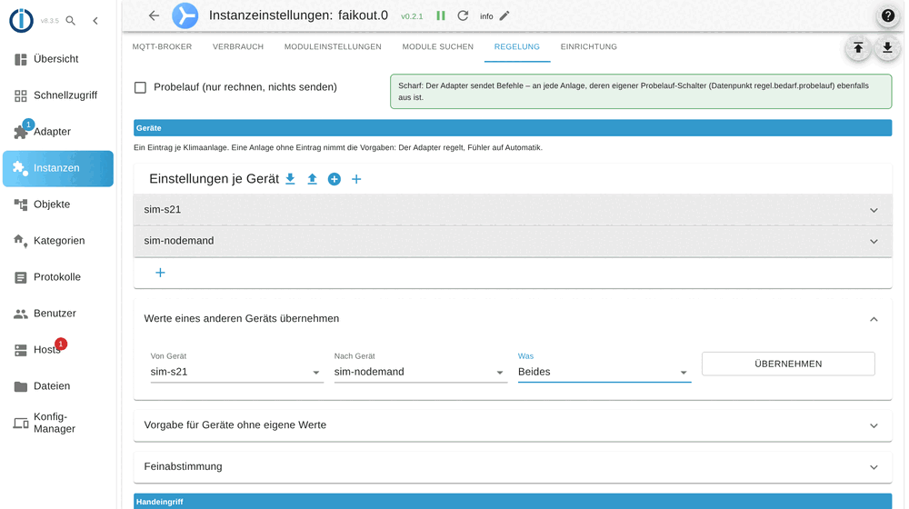
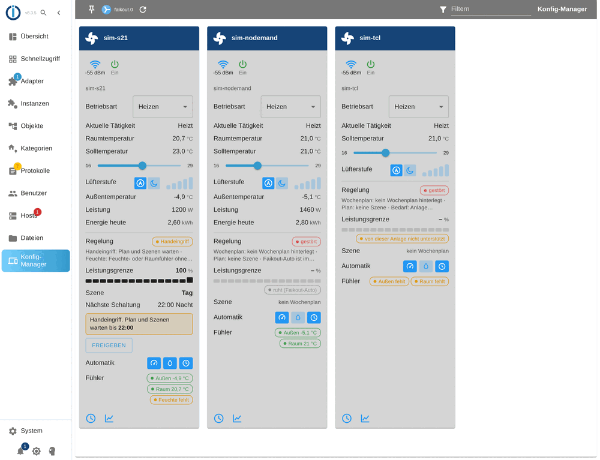
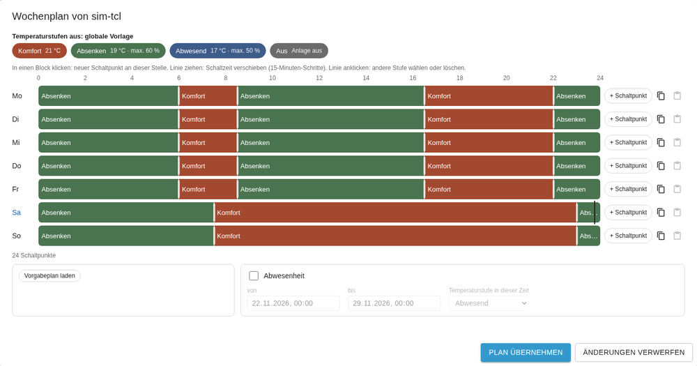
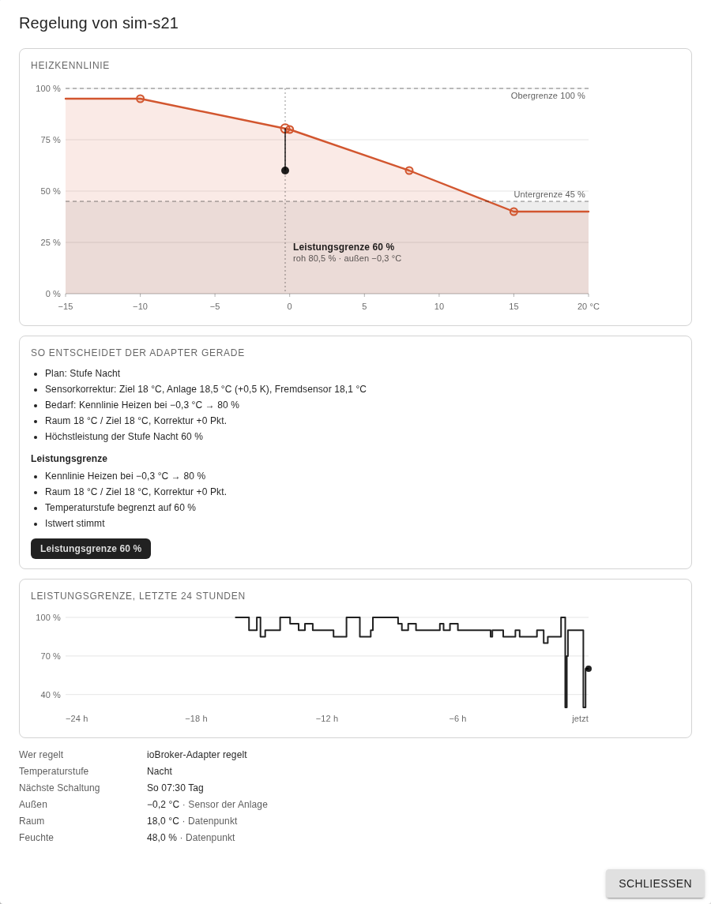
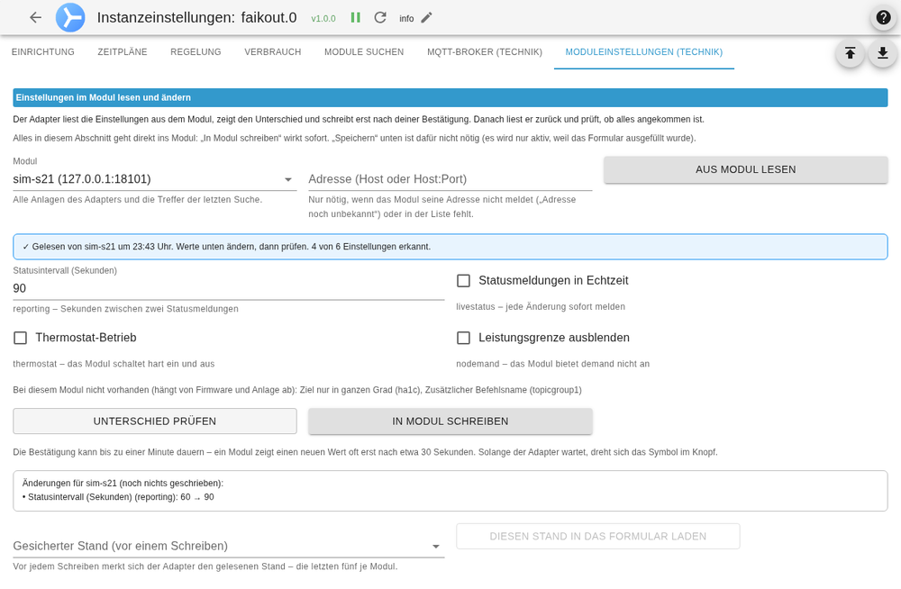
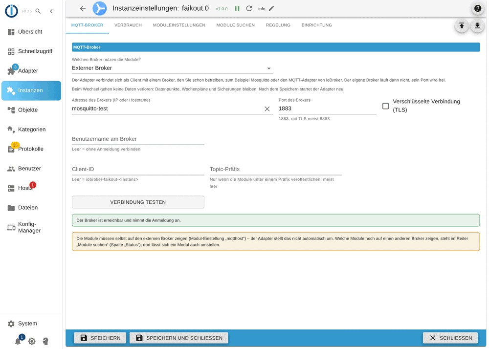
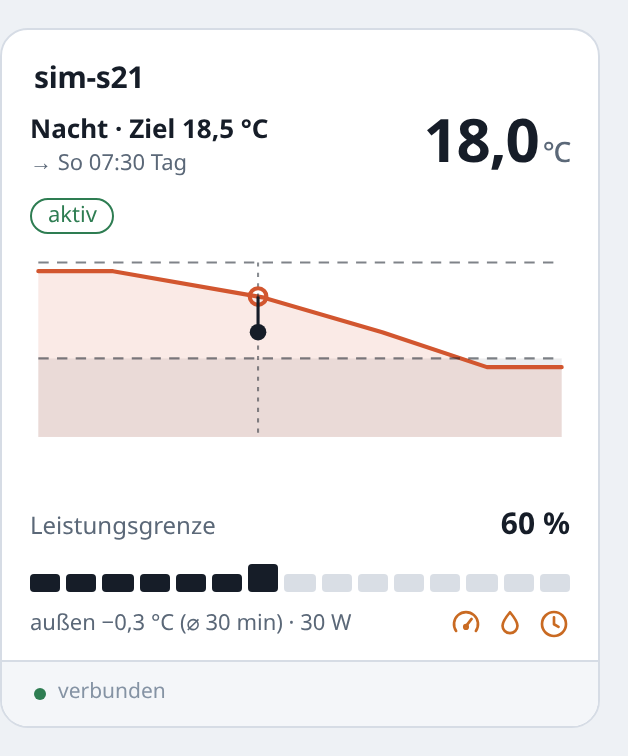

# Faikout – climate control

This guide describes the built-in climate control of the adapter: the settings in the tab
**Climate control**, the device cards, the weekly schedule and changing settings in the module.
[Deutsche Fassung](../de/README.md) · [Back to the overview](../../README.md)

## 1. Watch first: the dry run

After installation the control is in **dry run**. The adapter calculates everything and shows what
it would send – but it does not send a single command to the units. That leaves time to check
whether curve, scenes and schedule fit.

Going live takes two steps: the checkbox **Dry run** at the top of the tab *Climate control* (for
all units) and, per unit, the data point `<unit>.regel.bedarf.probelauf`. Commands are only sent
when both are off. Until then the device card carries the label "Dry run".

## 2. Settings per unit

Under **Units** there is one entry per air conditioner. A unit without an entry uses the defaults
(the adapter controls, sensors on automatic, curve and scenes from "Defaults for units without own
values").

### Who controls?

| Mode | What happens | Suited for |
| --- | --- | --- |
| **Adapter controls** | The adapter switches by weekly schedule and scenes, limits the power by demand and steps in on humidity. Nothing is stored in the module. | the normal case |
| **Faikout auto** | The module itself controls to the target temperature (automatic mode of the firmware). The adapter supplies target, sensor value and schedule. | when the module should keep controlling without ioBroker |

Limits of Faikout auto:

- The power limit is only set with the strategy **Auto**. With the strategy "curve", demand control
  rests; the card then says "rests (Faikout auto)".
- **Every change of the target is stored in the module (flash memory).** If the schedule changes
  the target six or more times on one day, the tab and the schedule dialog warn. For schedules
  with many switching times "Adapter controls" is the better choice.

### What this unit supports

Shown live: whether the unit accepts the power limit, whether a BLE sensor is attached to the
module and whether a humidity value is available.

#### Power limit on Daikin units

The power limit (`demand`) only has an effect on a Daikin unit if

1. the **original Daikin Wi-Fi module is switched on** (remote control: hold "Powerful" for
   5 seconds until "SP 1" appears). No internet and no cloud connection are needed, the app may be
   offline – and
2. **demand control is set to "On"** in the Daikin app.

"Off" in the app always means 100 %; values from the faikout module then have no effect. With
"On", both the app and faikout may write, the last value wins. "Auto" means the cloud controls. A
value rejected while the unit is switched off says nothing – the adapter keeps showing "not tested
yet".

### Demand control (power limit)

Demand control limits the power of the unit in 5 % steps so that it runs evenly instead of
cycling. If the room is 2 K or more below the target, the adapter always releases 100 %.

- **Curve by outside temperature:** points "outside °C → power %" as a table. The picture next to
  it redraws the curve at once, with lower and upper limit and – as soon as the unit reports
  values – the current operating point. The heating curve must fall (the colder, the more), the
  cooling curve must rise.
- **Auto (previous day + margin):** yesterday's power plus a reserve; this is how "Auto" in the
  Daikin app works as well. Without data from yesterday the adapter releases 100 %.

Empty fields take the default. Demand control is switched on per unit on the device card.

### Scenes

A scene is a complete state of the unit: on/off, mode, target temperature, fan and a **maximum power** that
limits the power additionally. Per scene you decide whether demand and humidity control work
during that time. Without own scenes four defaults apply: Komfort (21 °C), Absenken (19 °C),
Abwesend (17 °C) and Aus.

### Sensor sources and frost protection

Selectable for outside temperature, room temperature and humidity:

- **Automatic** – the best available sensor. A BLE sensor on the module always has priority (the
  firmware defines that).
- **Sensor of the unit**, **BLE sensor on the module** or any ioBroker **data point**.

If a value is too old, the adapter falls back to the next sensor and shows that in yellow on the
card. A room data point can take effect in two ways: the unit controls itself and the adapter
adjusts its setpoint (recommended, also for slow sensors in another room – the setpoint at the
unit then differs from the target by at most ±3 K), or the sensor value is sent to the module.

**Frost protection:** below the configured room temperature the adapter heats to 10 °C – even if
the schedule says off. 0 switches frost protection off.

### Take over values from another unit

With several units, scenes, strategy with curve and limits, or both can be copied from one unit to
another. After the confirmation the unit list is saved at once and the adapter restarts – save
other unsaved changes on the page first.

## 3. For all units

- **Manual override:** if someone operates the unit at the device or in an app, schedule and
  scenes wait – until the next switching time, for a fixed time, or not at all. Demand and
  humidity control keep working. "Release" on the card ends the wait at once.
- **Humidity and dew point:** ΔTP is the distance between room temperature and dew point. If it
  becomes too small or the humidity too high, the adapter switches to dry mode, lowers the target
  by 1 K when cooling, or only reports – depending on the setting, with a minimum run time and a
  pause.
- **Public holidays:** on public holidays the Sunday schedule can apply (German nationwide
  holidays and own dates).

## 4. Device cards

The card shows the running operation and offers everyday control:

- **Control:** state (active, manual override, not set up, fault, no connection, switched off) with
  the reason in plain text. "Not set up" means: the weekly schedule is switched on but none is stored
  yet (the button "Create schedule" appears at the top), or Faikout-Auto is still off in the module.
  Red ("fault") is shown for real faults only.
- **Target temperature:** slider for large steps, the buttons − and + next to it for one step of the
  unit (usually 0.5 K).
- **Sensors:** if a chosen data point is missing, the card names it and says which sensor is used
  instead.
- **Power limit** as a number and step bar, with a note when the adapter only calculates (dry
  run), the control rests or the unit does not accept the value.
- **Scene** and **next switch**.
- **Automation:** three symbol buttons switch demand control, humidity control and the weekly
  schedule on and off (filled = on).
- **Manual override:** note with the time and the button "Release".
- **Sensors:** green = the chosen sensor delivers, yellow = fallback or no value; the source is in
  the tooltip.

At the bottom of the card two buttons open the **weekly schedule** and the **details**.

### Weekly schedule

- Click into a block: new switching time there, then choose the scene.
- Drag a line: move the switching time (15-minute steps).
- Click a line: choose another scene or delete the switching time.
- On the right per day: "+ switching time", copy day, paste day.
- **Load default schedule** creates a simple schedule (mornings and evenings on weekdays, daytime
  at the weekend).
- **Absence:** from/until and the scene that applies during that time.

Nothing is saved before "OK". If the weekly schedule of the unit is switched off, the adapter then
asks whether to switch it on.

### Details

The details explain the current decision: curve with operating point, the calculation step by
step, the power limit of the last 24 hours and the sensors in use with their source.

## 5. Changing settings in the module

In the tab **Module settings**:

1. Choose the module (or enter its address) and **Read from module**. Reading uses HTTP GET only.
2. Change values in the form and **Check difference** – the preview names every change as
   "old → new".
3. **Write to module** and confirm. The adapter sends one single MQTT message with only the
   changed values, waits until the module answers again, reads back and shows the result per
   setting. This can take up to a minute: a module often shows a new value on its settings page
   only after about 30 seconds. Meanwhile the symbol in the button keeps spinning.

Before every write the adapter keeps the state it read (the last five per module). Under **Saved
state** it can be loaded into the form again and written back with the same procedure.

Important:

- Only a fixed list is written: status interval, live status messages, target in whole degrees,
  thermostat mode, hide power limit and the additional command name. Firmware/OTA, broker, Wi-Fi,
  passwords and the name of the module can never be changed from here.
- Which settings a module offers depends on firmware and unit. What is missing is named and never
  written.
- Every write wears the flash memory of the module and restarts it for some settings (about
  10 seconds without connection). Change deliberately, not for trying things out every minute.

## 6. Internal or external broker

By default the adapter runs its **own MQTT broker** – nothing else has to be installed, the
modules simply point to it. In the tab **MQTT broker** an **external broker** can be chosen
instead (for example Mosquitto or the ioBroker MQTT adapter). The adapter then connects as a
client; you enter address, port (1883, with TLS usually 8883), TLS if needed, user name, password,
client ID and a topic prefix.

- **Test connection** checks the values of the form before saving and says whether the broker is
  reachable, rejects the sign-in or does not answer.
- With an external broker the adapter's own broker does not run and its port becomes free.
- The modules must point to the external broker themselves (module setting `mqtthost`). The
  adapter does not change that automatically; the tab "Find modules" shows which modules still
  point to another broker and can switch a module over.
- Switching loses no data: data points, weekly schedules and saved states stay. After saving, the
  adapter restarts.

## 7. vis widget "Climate control"

The widget "Climate control (display)" shows state, scene and next switch, the curve with
operating point, the power limit and which controls are running for one unit. It is display only;
operation happens through the other widgets or the device card. The only attribute needed is the
device object, e.g. `faikout.0.Livingroom`.

## 8. Data points

Everything the interface shows is also available as data points below `<unit>.regel.*`, among
them `zustand`, `grund`, `bedarf.sollwert`, `plan.szene`, `plan.naechster`, `hand.gesperrt`,
`fuehler.*` and the switches `bedarf.aktiv`, `feuchte.aktiv` and `plan.aktiv`.

## 9. Consumption

The tab "Consumption" shows one chart for all units: stacked bars per day, week, month or year, each
unit in its own, permanently assigned colour; the bar height is the total. The chips above are the
legend – a click hides a unit. The tooltip lists the value per unit and the total; you can switch
between "All", "Heating only" and "Cooling only" and between chart and table. The data come from the
adapter's own counters (48 hours, 62 days, 24 months); no history adapter is needed.

