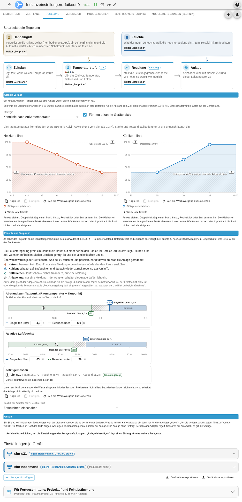

# Faikout – climate control

This guide describes the built-in climate control of the adapter: the settings in the tab
**Climate control**, the device cards, the weekly schedule and changing settings in the module.
[Deutsche Fassung](../de/README.md) · [Back to the overview](../../README.md)

## 1. Watch first: the dry run

After installation the control is in **dry run**. The adapter calculates everything and shows what
it would send – but it does not send a single command to the units. That leaves time to check
whether curve, temperature levels and schedule fit.

Going live takes two steps: the checkbox **Dry run** at the top of the tab *Climate control* (for
all units) and, per unit, the data point `<unit>.regulation.demand.dryRun`. Commands are only sent
when both are off. Until then the device card carries the label "Dry run".

### The tabs of the settings page

| Tab | What it holds |
|---|---|
| **Setup** | step list with ticks: broker, connect module, climate control, schedule |
| **Schedules** | WHEN which temperature applies: diagram of the control, temperature levels of the template (sliders to drag), weekly schedule of the template and per unit preview, switch and “Edit weekly schedule”. Collapsed: manual override and public holidays |
| **Climate control** | HOW the unit is run: dry run, the global template (strategy, curves and limits in the chart, humidity limits in the chart), below it the units. Collapsed: fine tuning |
| **Consumption** | chart and recording |
| **Find modules**, **MQTT broker (advanced)**, **Module settings (advanced)** | connecting and technical settings |

Per unit the tab *Climate control* always shows: who controls, sensors (with live value) and frost
protection. Strategy, curves and the unit’s own temperature levels only appear with the tick
**“Individual instead of global template”**; a coloured box says what currently applies.

## 2. Template and settings per unit

The control knows exactly two levels:

- the **global template** – strategy, lower and upper limit, heating and cooling curve, previous
  day, temperature levels, humidity action and the weekly schedule of the template. It applies to
  all units.
- **per unit** an entry under **Units** with the checkbox **"Individual instead of the global
  template"**.

| Checkbox "Individual" | What applies to the unit |
|---|---|
| off (default for new entries) | **all** values of the template. Own curves, limits or temperature levels in the entry stay stored but are not used. |
| on | the values of the unit. A single empty field still takes the template (and the template the factory default). |

Always per unit – with and without the checkbox – are: who controls, the sensor sources and frost
protection. A unit without any entry uses the template, the adapter controls and the sensors are
on automatic.

The factory defaults of the template: lower limit **40 %**, upper limit **100 %**, heating curve
−10 °C → 100 %, 0 °C → 75 %, 7 °C → 55 %, 15 °C → 40 %, cooling curve 25 °C → 40 %, 30 °C → 65 %,
35 °C → 95 %.

### Who controls?

| Mode | What happens | Suited for |
| --- | --- | --- |
| **Adapter controls** | The adapter switches by weekly schedule and temperature levels, limits the power by demand and steps in on humidity. Nothing is stored in the module. | the normal case |
| **Faikout auto** | The module itself controls to the target temperature (automatic mode of the firmware). The adapter supplies target, sensor value and schedule. | when the module should keep controlling without ioBroker |

Limits of Faikout auto:

- The power limit is only set with the strategy **Auto**. With the strategy "curve", demand control
  rests; the card then says "rests (Faikout auto)".
- **Every change of the target is stored in the module (flash memory).** If the schedule changes
  the target six or more times on one day, the tab and the schedule dialog warn. For schedules
  with many switching times "Adapter controls" is the better choice.

### What this unit supports

Shown live: whether the unit accepts the power limit, whether a BLE sensor is attached to the
module and whether a humidity value is available.

#### Power limit on Daikin units

The power limit (`demand`) only has an effect on a Daikin unit if

1. the **original Daikin Wi-Fi module is switched on** (remote control: hold "Powerful" for
   5 seconds until "SP 1" appears). No internet and no cloud connection are needed, the app may be
   offline – and
2. **demand control is set to "On"** in the Daikin app.

"Off" in the app always means 100 %; values from the faikout module then have no effect. With
"On", both the app and faikout may write, the last value wins. "Auto" means the cloud controls. A
value rejected while the unit is switched off says nothing – the adapter keeps showing "not tested
yet".

### Demand control (power limit)

Demand control limits the power of the unit in 5 % steps so that it runs evenly instead of
cycling. If the room is 2 K or more below the target, the adapter always releases 100 % – even
above a lower upper limit and above the maximum power of the temperature level. If the curve itself
reaches 100 % (factory default at −10 °C), that is an ordinary value: the maximum power of the
temperature level still limits it.

- **Curve by outside temperature:** points "outside °C → power %", dragged with the mouse in the
  picture (the table is collapsed). The picture shows lower and upper limit and – as soon as the
  unit reports values – the current operating point. The heating curve must fall (the colder, the more), the
  cooling curve must rise.
- **Auto (previous day + margin):** yesterday's power plus a reserve; this is how "Auto" in the
  Daikin app works as well. Without data from yesterday the adapter releases 100 %.

Empty fields take the default. Demand control is switched on per unit on the device card.

### Temperature levels

Temperature levels (formerly "scenes") are in the tab **Schedules** – where they are needed: the
weekly schedule switches between them. A temperature level is a complete state of the unit: on/off,
mode, target temperature, fan and a **maximum power** that additionally limits the power coming from
the control. Per level you decide whether demand and humidity control work during that time.
Without own levels four factory levels apply:

| Level | Target | Fan | Maximum power |
|---|---|---|---|
| Comfort (`komfort`) | 21 °C | auto | 100 % |
| Setback (`absenken`) | 19 °C | night | 60 % |
| Away (`abwesend`) | 17 °C | auto | 50 % |
| Off (`aus`) | unit off | – | – |

The levels of the template apply to all units; a unit with the checkbox "Individual" can have its
own.

### Sensor sources and frost protection

Selectable for outside temperature, room temperature and humidity:

- **Automatic** – the best available sensor. A BLE sensor on the module always has priority (the
  firmware defines that).
- **Sensor of the unit**, **BLE sensor on the module** or any ioBroker **data point**.

If a value is too old, the adapter falls back to the next sensor and shows that in yellow on the
card. A room data point can take effect in two ways: the unit controls itself and the adapter
adjusts its setpoint (recommended, also for slow sensors in another room – the setpoint at the
unit then differs from the target by at most ±3 K), or the sensor value is sent to the module.

**Frost protection:** below the configured room temperature the adapter heats to 10 °C – even if
the schedule says off. 0 switches frost protection off.

### Copy, paste, reset

Below every chart (curve, temperature levels, humidity, weekly schedule) there are three buttons:
**Copy** remembers the content, **Paste** inserts it at another unit or in the template (grey as
long as nothing suitable has been copied), **Apply template** or **Factory default** resets. After
pasting or resetting, **Undo** is offered for a short time. Curves, levels and humidity limits only
apply with “Save”; a weekly schedule at a unit takes effect at once.

## 3. For all units

- **Manual override:** if someone operates the unit at the device or in an app, schedule and
  temperature levels wait – until the next switching time, for a fixed time, or not at all. Demand and
  humidity control keep working. "End manual override" on the card ends the wait at once.
- **Humidity and dew point:** ΔDP (dew-point spread) is the distance between room temperature and
  dew point. If it becomes too small or the humidity too high, the adapter switches to dry mode,
  lowers the target by 1 K when cooling, or only reports – depending on the setting, with a minimum
  run time and a pause.
- **Public holidays:** on public holidays the Sunday schedule can apply (German nationwide
  holidays and own dates).

## 4. Device cards

The card shows the running operation and offers everyday control:

- **Control:** state (active, manual override, not set up, fault, no connection, switched off) with
  the reason in plain text. "Not set up" means: the weekly schedule is switched on but none is stored
  yet (the button "Create schedule" appears at the top), or Faikout-Auto is still off in the module.
  Red ("fault") is shown for real faults only.
- **Target temperature:** slider for large steps, the buttons − and + next to it for one step of the
  unit (usually 0.5 K).
- **Sensors:** if a chosen data point is missing, the card names it and says which sensor is used
  instead.
- **Power limit** as a number and step bar, with a note when the adapter only calculates (dry
  run), the control rests or the unit does not accept the value.
- **Temperature level** and **next switch**, below them the pointer to the button "Weekly schedule".
- **Automation:** three symbol buttons switch demand control, humidity control and the weekly
  schedule on and off (filled = on).
- **Manual override:** note with the time and the button "End manual override".
- **Sensors:** green = the chosen sensor delivers, yellow = fallback or no value; the source is in
  the tooltip.

At the bottom of the card the labelled button **Weekly schedule** (with the calendar symbol) opens
the weekly schedule of this unit, the button next to it the **details**.

### Weekly schedule

The weekly schedule is available in two places – it is the same editor and the same schedule:

- in the tab **Schedules** of the settings: one row per unit with a preview of the week, the switch
  "active" and "Edit weekly schedule"; schedules can be copied and pasted between units,
- on the **device card**: button "Weekly schedule".

The weekly schedule is stored per unit in the data point `regulation.schedule.weekJson` and **takes
effect at once** – it does not need "Save" on the settings page. The **schedule of the template**,
however, is a value of the settings: "Load default schedule" in the editor inserts it (without a
template schedule the factory schedule).

- Click into a block: new switching time there, then choose the temperature level.
- Drag a line: move the switching time (15-minute steps).
- Click a line: choose another level or delete the switching time.
- On the right per day: "+ switching time", copy day, paste day.
- **Load default schedule** inserts the schedule of the template; without one the factory schedule
  (comfort in the mornings and evenings on weekdays, daytime at the weekend).
- **Absence:** from/until and the temperature level that applies during that time.

Nothing is saved before "Apply schedule". If the weekly schedule of the unit is switched off, the adapter then
asks whether to switch it on.

### Details

The details explain the current decision: curve with operating point, the calculation step by
step, the power limit of the last 24 hours and the sensors in use with their source.

## 5. Changing settings in the module

In the tab **Module settings**:

1. Choose the module (or enter its address) and **Read from module**. Reading uses HTTP GET only.
2. Change values in the form and **Check difference** – the preview names every change as
   "old → new".
3. **Write to module** and confirm. The adapter sends one single MQTT message with only the
   changed values, waits until the module answers again, reads back and shows the result per
   setting. This can take up to a minute: a module often shows a new value on its settings page
   only after about 30 seconds. Meanwhile the symbol in the button keeps spinning.

Before every write the adapter keeps the state it read (the last five per module). Under **Saved
state** it can be loaded into the form again and written back with the same procedure.

Important:

- Only a fixed list is written: status interval, live status messages, target in whole degrees,
  thermostat mode, hide power limit and the additional command name. Firmware/OTA, broker, Wi-Fi,
  passwords and the name of the module can never be changed from here.
- Which settings a module offers depends on firmware and unit. What is missing is named and never
  written.
- Every write wears the flash memory of the module and restarts it for some settings (about
  10 seconds without connection). Change deliberately, not for trying things out every minute.

## 6. Internal or external broker

By default the adapter runs its **own MQTT broker** – nothing else has to be installed, the
modules simply point to it. In the tab **MQTT broker** an **external broker** can be chosen
instead (for example Mosquitto or the ioBroker MQTT adapter). The adapter then connects as a
client; you enter address, port (1883, with TLS usually 8883), TLS if needed, user name, password,
client ID and a topic prefix.

- **Test connection** checks the values of the form before saving and says whether the broker is
  reachable, rejects the sign-in or does not answer.
- With an external broker the adapter's own broker does not run and its port becomes free.
- The modules must point to the external broker themselves (module setting `mqtthost`). The
  adapter does not change that automatically; the tab "Find modules" shows which modules still
  point to another broker and can switch a module over.
- Switching loses no data: data points, weekly schedules and saved states stay. After saving, the
  adapter restarts.

## 7. vis widget "Climate control"

The widget "Climate control (display)" shows state, temperature level and next switch, the curve with
operating point, the power limit and which controls are running for one unit. It is display only;
operation happens through the other widgets or the device card. The only attribute needed is the
device object, e.g. `faikout.0.Livingroom`.

## 8. Data points

Everything the interface shows is also available as data points below `<unit>.regulation.*`, among
them the channels `demand` (demand limit), `schedule` (weekly schedule), `humidity`, `manual`
(manual override), `target` (buttons warmer/cooler) and `sensors`. Whether the unit accepts a demand
limit is shown in `<unit>.info.demandCapable` (`unknown`, `yes`, `no`).

| Data point below `regulation.` | Values | Meaning |
|---|---|---|
| `state` | ok · manual · setup · fault · offline · off | overall state of the control |
| `reason` |  | reason in plain text |
| `mode` | adapter · faikout | who controls |
| `lastCommand` |  | last command (JSON; in dry run: would send) |
| `historyJson` |  | demand limit of the last 24 hours |
| `demand.active` · `demand.dryRun` |  | switches: demand limit, dry run per unit |
| `demand.setpoint` · `rawValue` · `outsideMean` |  | calculated limit, raw value, outside mean (30 min) |
| `demand.state` · `demand.reason` | ok · fault · notCapable · neutral · off | state and reason of the demand limit |
| `demand.strategy` | curve · previousDay | strategy |
| `demand.wouldSend` · `commandsPerHour` |  | last demand command, commands in the last hour |
| `demand.curveJson` · `capableReason` · `stateJson` |  | curve of the unit, reason of the capability, internal state (restart-safe) |
| `schedule.active` · `weekJson` · `absenceJson` |  | switch, weekly schedule and absence |
| `schedule.level` · `next` · `nextLevel` · `missing` |  | current temperature level, next switching time with its level, "no schedule stored yet" |
| `humidity.active` · `dewPoint` · `margin` · `intervention` · `reason` |  | humidity control: switch, dew point, spread, intervention, reason |
| `manual.locked` · `until` · `resume` |  | manual override: automation waits, until when, button "resume" |
| `target.up` · `target.down` |  | buttons: target temperature one step warmer/cooler |
| `sensors.outside` · `room` · `humidity` |  | sensor values in use |
| `sensors.…Source` · `…Status` · `…Kind` | Status: ok · fallback · missing; Kind: ble · dp · internal | source in plain text, status and kind per sensor |
| `sensors.correction` · `target` · `note` |  | sensor correction, target at the room sensor, note on a missing data point |

Pre-release builds of 1.0.0 kept these data points below `<unit>.regel.*`. The adapter moves them
once at start (switches, weekly schedule, absence, history and your own history settings are kept)
and removes the old objects.

With the renaming of "scenes" to "temperature levels" two data points have new names. The adapter
moves them at start as well (value and history settings are kept):

| old | new |
|---|---|
| `regulation.schedule.scene` (pre-release: `regel.plan.szene`) | `regulation.schedule.level` |
| `regulation.schedule.nextScene` (pre-release: `regel.plan.naechsteSzene`) | `regulation.schedule.nextLevel` |

### Settings: old → new

At the first start with 1.0.0 the adapter migrates the instance settings once and then restarts.
Your own values are never overwritten.

| old | new | migration |
|---|---|---|
| `regelSzenen` | `regelStufen` | list is taken over |
| per unit `szenen` | per unit `stufen` | list is taken over |
| – | per unit `individuell` | existing entries get the checkbox – they behave as before |
| – | `regelPlanVorlage` | new, empty = factory schedule |
| `regelObergrenze` 95 | 100 | only if the old factory default 95 is still set |
| heating curve −10 °C → 95 % | −10 °C → 100 % | only if the curve is exactly the old factory default |
| `User` (pre-release 0.5.0) | `user` | user name of the built-in broker is taken over – the modules stay logged in |

### JSON data points

The keys inside the JSON data points are English. Pre-release builds of 1.0.0 wrote German keys: the
adapter still reads them (also when a script keeps writing the old format), writes English keys
only, and rewrites stored old values once at start.

| Data point | old | new | Example (new) |
|---|---|---|---|
| `demand.curveJson` | `heizen` · `kuehlen` · `untergrenze` · `obergrenze` | `heating` · `cooling` · `lowerLimit` · `upperLimit` | `{"heating":[[-10,100],[0,75],[7,55],[15,40]],"cooling":[[25,40],[30,65],[35,95]],"lowerLimit":40,"upperLimit":100}` |
| `lastCommand` | `felder` · `zeit` · `aktion` (`senden`/`wuerde`) | `fields` · `time` · `action` (`send`/`would`) | `{"fields":{"target":22,"fan":"auto"},"time":"2026-11-21T11:38:19.361Z","action":"send"}` |
| `demand.wouldSend` | `wert` · `zeit` · `aktion` (`senden`/`wuerde`) · `ist` | `value` · `time` · `action` (`send`/`would`) · `current` | `{"value":85,"time":"2026-11-21T12:14:38.489Z","action":"would","current":100}` |
| `schedule.absenceJson` | `von` · `bis` · `szene` (for a while `scene`) | `from` · `to` · `level` | `{"from":1798326000000,"to":1798930800000,"level":"abwesend"}` (time in ms or as ISO text; empty = no absence) |

Unchanged, because they never had German keys: `schedule.weekJson` (seven days starting on Monday,
each switching time `{"t": minutes since midnight, "s": ID of the temperature level}`), `historyJson` (pairs
`[time in ms, percent]`) and `consumption.*Json` (`hour`/`day`/`month`, `kwh`). `demand.stateJson` is
the adapter's memory across a restart – not an interface, its structure may change at any time.

The IDs of the temperature levels (`komfort`, `absenken`, `abwesend`, `aus`, or derived from your
own name) are language-independent and stay as they are: the weekly schedule refers to them –
existing schedules remain valid. Only the displayed name of the four factory levels follows the
system language; your own levels keep their names.

## 9. Consumption

The tab "Consumption" shows one chart for all units: stacked bars per day, week, month or year, each
unit in its own, permanently assigned colour; the bar height is the total. The chips above are the
legend – a click hides a unit. The tooltip lists the value per unit and the total; you can switch
between "All", "Heating only" and "Cooling only" and between chart and table. The data come from the
adapter's own counters (48 hours, 62 days, 24 months); no history adapter is needed.

